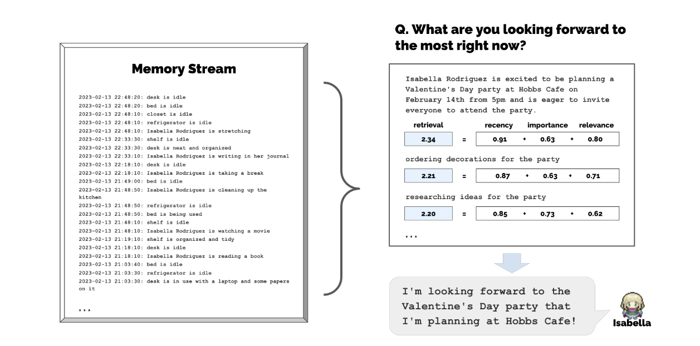
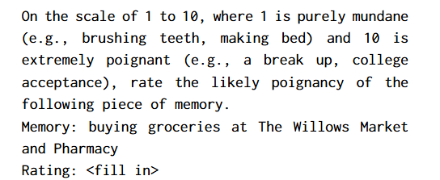
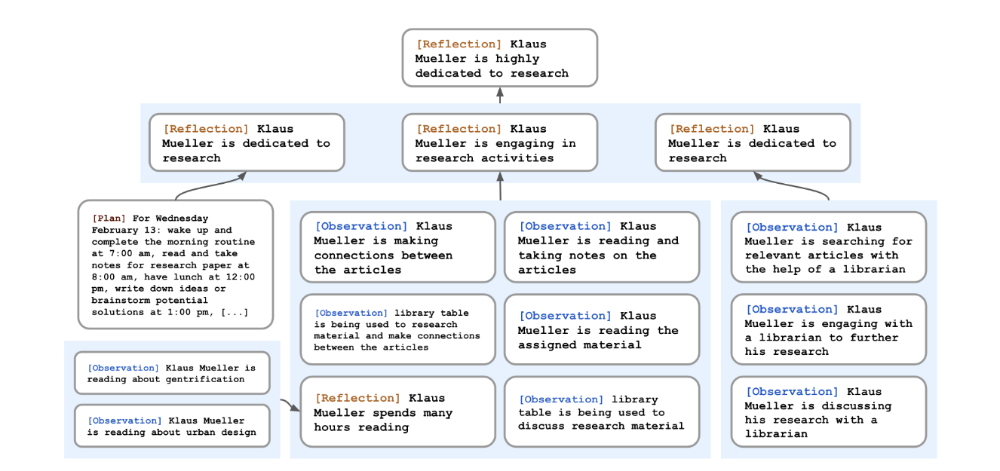

# Generative Agents: Interactive Simulacra of Human Behavior

核心由 Memory Stream、Reflection 和 Planning 组成：记录经历、提炼理解，再用这些信息安排和调整行动。

The core components are Memory Stream, Reflection, and Planning: record experiences, derive insights, and use them to organize and revise actions.

## Memory Stream

Memory Stream 用自然语言长期记录 Agent 的经历。检索时，综合 Recency、Relevance 和 Importance 三个分数，原文中的三个权重均设为 1。

The Memory Stream records the Agent's experiences in natural language. Retrieval combines Recency, Relevance, and Importance; all three weights are set to 1 in the described implementation.

$$
score = \alpha_{recency} \cdot recency + \alpha_{relevance} \cdot relevance + \alpha_{importance} \cdot importance
$$

### Relevance

与当前情境越相关的记忆，分数越高。将记忆描述与当前 Query 转为 Embedding，再用 cosine similarity 计算相关性。

Memories more relevant to the current situation receive higher scores. Relevance is computed as cosine similarity between the memory description's Embedding and the Query Embedding.

### Recency

最近访问过的记忆获得更高分数。原实现使用 0.995 的衰减系数。

Recently accessed memories receive higher scores. The described implementation uses a decay factor of 0.995.

### Importance

Importance 区分日常琐事与重要经历。可以直接让 LLM 根据记忆内容输出整数分数，下面展示原文的 Prompt。

Importance distinguishes routine events from significant experiences. The LLM assigns an integer score to a memory; the original scoring prompt is shown below.

## Reflection

Reflection 把具体经历整理成更高层的理解，并将结论写回 Memory Stream：

1. **提出问题：** 读取最近 100 条记忆，提出 3 个值得回答的高层问题。
2. **检索证据：** 找到相关记录，提炼 Insight，并引用支持该结论的记忆。
3. **写回记忆：** 保存 Reflection，同时保留指向证据记录的引用。

Reflection turns individual experiences into higher-level insights and writes them back to the Memory Stream:

1. **Ask questions:** read the 100 most recent memories and identify three salient high-level questions.
2. **Retrieve evidence:** find relevant records, derive insights, and cite the memories supporting them.
3. **Store reflections:** save the insights with pointers to their supporting memory records.

## Planning and Reacting

Agent 需要在较长时间范围内规划，让行动连贯且可信。过程包括：生成初始计划、逐层细化计划、根据新事件调整计划，以及开展对话。

Agents plan over longer time horizons to keep their actions coherent and believable. The process includes creating an initial plan, recursively refining it, reacting to new events, updating plans, and engaging in dialogue.
