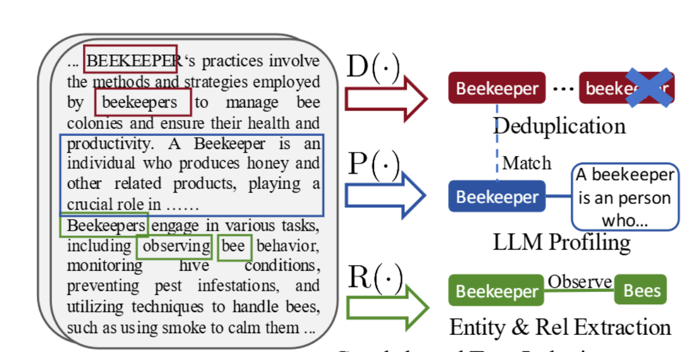
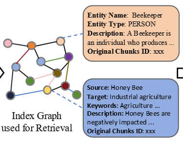
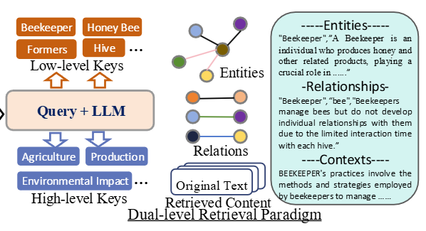

# LightRAG

## Why LightRAG

LightRAG 将文本组织为知识图谱，通过 Low-Level 与 High-Level 两级检索同时获取具体实体信息和整体主题，并支持增量加入新数据。

LightRAG organizes text into a knowledge graph, combines Low-Level and High-Level retrieval for entity details and broader themes, and supports incremental updates as new data arrives.

## Overall architecture

### 1. Text indexing

索引阶段从文本中提取实体与关系，生成概况信息，并去重合并。图中的 `D(.)` 表示 Deduplication，`P(.)` 表示 Profiling，`R(.)` 表示 Relationship Extraction。

Indexing extracts entities and relationships, creates profiles, and merges duplicates. In the diagram, `D(.)` denotes Deduplication, `P(.)` denotes Profiling, and `R(.)` denotes Relationship Extraction.

### 2. Graph storage

实体和关系保存在图结构中，支持语义检索。节点表示概念或实体，边表示它们之间的关系。

Entities and relationships are stored in a graph for semantic retrieval. Nodes represent concepts or entities, and edges represent their relationships.

### 3. Dual-level retrieval

收到 Query 后，系统同时检索两类 Key：

- **Low-Level Keys：** Query 直接提到的具体词，例如 Beekeeper、Honey Bee、Hive。
- **High-Level Keys：** 由 LLM 提炼的抽象主题，例如 Agriculture、Production、Environmental Impact。

For a Query, the system retrieves two levels of keys:

- **Low-Level Keys:** specific terms mentioned directly, such as Beekeeper, Honey Bee, and Hive.
- **High-Level Keys:** abstract themes extracted by the LLM, such as Agriculture, Production, and Environmental Impact.

