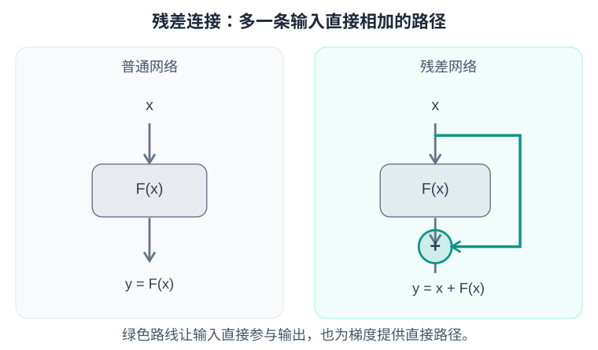

# 梯度下降与反向传播

**Loss 衡量当前结果，梯度说明参数如何影响 Loss，优化器据此更新参数。**

**Loss measures the current result. Gradients describe how parameters affect Loss, and the optimizer uses them to update the parameters.**

## 1. 从求导到梯度下降

| 符号 | 含义 |
| --- | --- |
| $\theta$ | 模型参数，通常是一个包含大量权重的向量 |
| $L$ | 损失函数，训练时希望减小的目标 |
| $\partial L/\partial\theta_i$ | Loss 对某一个参数的偏导数 |
| $\nabla_\theta L$ | 把所有参数的偏导数组合起来，得到梯度向量 |
| $\eta$ | 学习率，控制更新步长 |

梯度指向 Loss 在当前位置增加最快的方向，所以梯度下降沿着反方向更新：

$$
\theta_{\mathrm{new}}=\theta_{\mathrm{old}}-\eta\nabla_\theta L
$$

例如，Loss 是两个参数的平方和，当前参数为 (3, 4)，梯度为 (6, 8)。学习率取 0.1，更新后参数变成 (2.4, 3.2)，Loss 从 25 降到 16。

$\theta$ is the parameter vector, $L$ is the training objective, and $\partial L/\partial\theta_i$ is the derivative with respect to one parameter. Collecting these derivatives gives the gradient $\nabla_\theta L$. The learning rate $\eta$ controls the step size.

The gradient points toward the steepest local increase in Loss, so gradient descent updates parameters in the opposite direction using the rule above.

For a sum-of-squares Loss with parameters (3, 4), the gradient is (6, 8). With a learning rate of 0.1, the parameters become (2.4, 3.2), reducing Loss from 25 to 16.

## 2. 梯度怎么一层层传回去？

**前向传播计算结果和 Loss；反向传播沿计算图应用链式法则，计算每个参数的梯度。**

看一个两层网络：

$$
h=w_1x,\qquad y=w_2h,\qquad L=\frac12(y-t)^2
$$

取输入 x=2、参数 w₁=3、w₂=4，目标值 t=20。前向计算得到 h=6、y=24、Loss=8。

反向计算时，把上游梯度乘上当前这一步的导数：

| 位置 | 计算 | 梯度 |
| --- | --- | --- |
| 输出 $y$ | $y-t$ | 4 |
| 第二层参数 $w_2$ | $4\times h$ | 24 |
| 中间结果 $h$ | $4\times w_2$ | 16 |
| 第一层参数 $w_1$ | $16\times x$ | 32 |

第一层参数虽然离 Loss 更远，也能沿着 w₁ → h → y → Loss 算出影响：

$$
\frac{\partial L}{\partial w_1}
=\frac{\partial L}{\partial y}
\frac{\partial y}{\partial h}
\frac{\partial h}{\partial w_1}
=4\times4\times2=32
$$

反向传播得到梯度后，优化器再更新参数。PyTorch 中的 loss.backward() 负责计算并累积梯度，optimizer.step() 负责更新参数。

**The forward pass computes predictions and Loss. Backpropagation applies the chain rule along the computation graph to obtain parameter gradients.**

In the two-layer example above, x=2, w₁=3, w₂=4, and t=20 give h=6, y=24, and Loss=8. Backpropagation multiplies each upstream gradient by the local derivative:

| Quantity | Calculation | Gradient |
| --- | --- | --- |
| Output $y$ | $y-t$ | 4 |
| Parameter $w_2$ | $4\times h$ | 24 |
| Intermediate $h$ | $4\times w_2$ | 16 |
| Parameter $w_1$ | $16\times x$ | 32 |

The path w₁ → h → y → Loss gives the first parameter's gradient as 32. Distance from the output does not prevent a parameter from receiving a gradient.

In PyTorch, `loss.backward()` computes and accumulates gradients; `optimizer.step()` then updates parameters.

## 3. 梯度会越往前越大吗？

梯度传播会连续乘上中间各步的导数，因此既可能放大，也可能缩小。

| 情况 | 每步局部导数的例子 | 连乘 10 次 | 结果 |
| --- | --- | --- | --- |
| 梯度消失 | 0.5 | 约 0.001 | 前面的层收到的学习信号很弱 |
| 梯度爆炸 | 2 | 1024 | 过大的梯度容易使更新不稳定 |

关键取决于沿途导数的乘积，而不是单纯取决于“离 Loss 有多远”。

Backpropagation repeatedly multiplies local derivatives, so gradients can either shrink or grow.

| Case | Local derivative | Product over 10 steps | Effect |
| --- | --- | --- | --- |
| Vanishing gradients | 0.5 | About 0.001 | Earlier layers receive weak learning signals |
| Exploding gradients | 2 | 1024 | Large gradients can destabilize updates |

The product of derivatives along the path matters, rather than distance from Loss alone.

## 4. 残差连接为什么有帮助？

普通网络输出变换后的结果；残差连接把原输入也加回来：

$$
y=x+F(x)
$$

输入 x 对自身的导数是 1，所以反向传播多了一条直接路径：

$$
\frac{\partial L}{\partial x}
=\frac{\partial L}{\partial y}\bigl(1+F'(x)\bigr)
$$

例如 F′(x)=0.01，普通路径会把梯度乘以 0.01，残差结构则乘以 1.01，有助于缓解梯度消失。Transformer 的 Attention 和 MLP 外围都使用了残差连接；训练稳定性还会结合归一化、初始化和残差缩放来改善。[残差网络论文](https://arxiv.org/abs/1512.03385)

A residual connection adds the input to the transformed output, as shown in the formula and diagram above.

The identity path has derivative 1, providing a direct route for gradients. If F′(x)=0.01, the ordinary path multiplies the upstream gradient by 0.01, while the residual path multiplies it by 1.01. This helps reduce gradient vanishing.

Transformer Attention and MLP blocks use residual connections. Normalization, initialization, and residual scaling also help stabilize training.

## 5. 梯度裁剪限制什么？

**梯度裁剪是在参数更新之前，限制梯度向量的长度（范数）。**

以最大 L2 范数设为 1 为例：

- 梯度长度不超过 1：保持原样。
- 梯度长度超过 1：整体等比例缩小，保留方向。

例如梯度是 (3, 4)，长度为 5；整体除以 5 后变成 (0.6, 0.8)，长度变成 1。

训练顺序是：

**前向计算 → Loss → 反向传播 → 梯度裁剪 → 优化器更新**

阈值控制的是裁剪后的总梯度范数；反向传播的中间梯度仍可能很大。优化器还会结合学习率、动量等信息决定实际更新量。[PyTorch 梯度裁剪文档](https://docs.pytorch.org/docs/stable/generated/torch.nn.utils.clip_grad_norm_.html)

**Gradient clipping limits the gradient norm before the optimizer update.** With a maximum L2 norm of 1, gradients of norm at most 1 stay unchanged; larger gradients are scaled down uniformly, preserving their direction.

For example, (3, 4) has norm 5. Dividing by 5 gives (0.6, 0.8), with norm 1.

The training sequence is **forward pass → Loss → backpropagation → gradient clipping → optimizer update**.

The threshold applies to the final gradient norm. Intermediate gradients during backpropagation can still be large, and the optimizer also uses the learning rate and momentum to determine the actual update.
