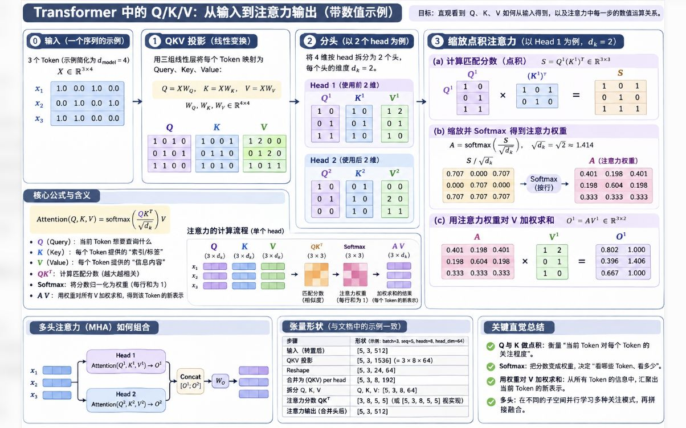

# Transformer

Attention 让每个 Token 根据相关性读取其他可见位置的信息。理解它的计算过程后，就能顺着理解多头、KV Cache，以及 GQA、MLA 等结构如何减少缓存。

Attention lets each token read information from visible positions according to relevance. Its computation provides the foundation for understanding multiple heads, KV caching, and architectures such as GQA and MLA.

- [1. 输入与 Hidden States](#1-输入与-hidden-states)
- [2. 单头 Attention：从 QKV 到输出](#2-单头-attention从-qkv-到输出)
- [3. 多头 Attention：分头、位置与维度](#3-多头-attention分头位置与维度)
- [4. 推理：Prefill、Decode 与 KV Cache](#4-推理prefilldecode-与-kv-cache)
- [5. 真实模型：MHA、GQA 与 MLA](#5-真实模型mhagqa-与-mla)
- [6. 应用：文档 Memory Cache](#6-应用文档-memory-cache)
- [附录：张量布局与实现](#附录张量布局与实现)

## 1. 输入与 Hidden States

### 1.1 文本如何变成向量？

以“小王去银行取钱”为例，假设 Tokenizer 将它切成 `小王 / 去 / 银行 / 取 / 钱` 这 5 个 Token。实际切分由模型的 Tokenizer 决定。每个 Token 先变成一个整数 ID，再用这个 ID 查 Embedding 表，得到一个 `hidden_size` 维的向量。

若 `hidden_size=512`，这句话的表示就是 `[5, 512]`：5 个位置，每个位置有 512 个数。**序列长度、词表大小、Embedding 维度是三个不同的量。** 向量中的分量由训练学习，不是预先指定的“地点”“动作”等字段。

For illustration, suppose the tokenizer splits the sentence into five tokens: `小王 / 去 / 银行 / 取 / 钱`. Actual tokenization depends on the model. Each token becomes an integer ID, which indexes an Embedding table to retrieve a `hidden_size`-dimensional vector.

With `hidden_size=512`, the sentence has shape `[5, 512]`: five positions with 512 values each. **Sequence length, vocabulary size, and Embedding dimension are distinct quantities.** Components are learned features rather than predefined fields such as location or action.

```text
Text → Token IDs [5] → Embedding lookup → Hidden States [5, 512]
```

### 1.2 Attention 在模型的什么位置？

在常见的 Decoder Transformer 中，Embedding 后是多层 Transformer Block。每层的 Attention 在 Token 之间读取信息，FFN / MoE 对各位置的特征继续变换，并配合归一化和残差连接。最后，LM Head 将模型表示映射为词表上的预测分数。

第一层继承输入 Embedding；后续层接收上一层输出的 Hidden States。因此，**每层都从自己的输入计算自己的 Q、K、V**。下面用 X 表示当前 Attention 的输入；具体实现中，X 可能是经过归一化的层输入。

In a typical Decoder Transformer, embeddings pass through multiple Transformer blocks. Attention exchanges information between token positions, while the FFN or MoE transforms features at each position. Normalization and residual connections accompany these operations. The LM Head maps the final representations to vocabulary prediction scores.

The first layer receives the input embeddings, and later layers receive the preceding layer's Hidden States. **Each layer computes its own Q, K, and V from its own input.** Below, X denotes the current Attention input, which may already be normalized.

## 2. 单头 Attention：从 QKV 到输出

先固定一个样本、一个 head，理解一次完整计算：**生成 QKV → 点积打分 → 缩放与 Mask → softmax → 加权 V**。

First fix one sample and one head: **project QKV → compute dot products → scale and mask → apply softmax → combine V**.

### 2.1 Q、K、V 从哪里来，各自做什么？

同一个输入 X 分别经过三个可学习的线性投影，得到 Q、K、V。这里采用行向量约定，省略 bias。

The same input X passes through three learned linear projections to produce Q, K, and V. The equations use row vectors and omit biases.

$$
Q=XW_Q,\qquad K=XW_K,\qquad V=XW_V
$$

| 张量 / Tensor | 作用 / Role |
| --- | --- |
| Q — Query | 当前 Token 发起匹配的向量 / What the current token queries with |
| K — Key | 各个可见位置参与匹配的向量 / What each visible position is matched against |
| V — Value | 各个位置提供、被加权组合的内容 / The content each position contributes |

例如，“钱”这个位置的 Q 可以与前面“小王”“银行”“取”等位置的 K 匹配，再按权重组合它们的 V。实际权重由模型学习。**Q、K 决定各位置的权重，V 提供被加权的内容；同一位置的 K 与 V 对应同一个 Token。**

For example, the query at `钱` can match keys at preceding positions such as `小王`, `银行`, and `取`, then combine their values. The actual weights are learned. **Q and K determine weights over positions; V supplies the content. Each key is paired with the value at the same token position.**

### 2.2 点积如何得到匹配分数？

用一个二维例子手算：一个 Query 读取三个可见 Token。点积将对应分量相乘后相加，因此两个向量得到一个标量分数。

For a small numerical example, let one two-dimensional query read three visible tokens. A dot product multiplies corresponding components and sums them, producing one scalar score from two vectors.

```text
q  = [1, 0]
K₁ = [1, 0]     q · K₁ = 1×1 + 0×0 = 1
K₂ = [0, 1]     q · K₂ = 1×0 + 0×1 = 0
K₃ = [1, 0]     q · K₃ = 1×1 + 0×0 = 1
```

### 2.3 为什么缩放，Mask 和 softmax 又做什么？

**缩放：** 每头 Q/K 的维度记作 `d_k`，点积除以 `√d_k`。若各分量独立、均值为 0、方差为 1，点积的方差会随 `d_k` 增大；这样缩放能使方差保持在约 1，减少 softmax 过于极端。本例 `d_k=2`，缩放分数约为 `[0.707, 0, 0.707]`。

**Mask：** 先限制哪些位置可读，再分配权重。Causal Mask 屏蔽未来 Token，Padding Mask 屏蔽补齐的 Key 位置。实现中可将不可见位置的分数设为负无穷，使其 softmax 权重为 0。本例三个位置都可见。

**Softmax：** 对同一个 Query 的所有可见 Key 一起归一化，得到权重，权重之和为 1。本例约为 `[0.401, 0.198, 0.401]`。softmax 沿 Key 位置计算，不是对每个分数分别计算。

**Scaling:** Divide dot products by `√d_k`, where `d_k` is the Q/K dimension per head. With independent, zero-mean, unit-variance components, dot-product variance grows with `d_k`; scaling brings it back to roughly 1 and reduces extreme softmax outputs. Here, `d_k=2` gives scaled scores of approximately `[0.707, 0, 0.707]`.

**Masking:** Determine visibility before assigning weights. Causal masks block future tokens, and padding masks block padded key positions. Setting a blocked score to negative infinity gives it zero softmax weight. All three positions are visible in this example.

**Softmax:** Normalize across visible keys for the same query, producing weights that sum to 1. Here they are approximately `[0.401, 0.198, 0.401]`. Softmax operates over key positions, not independently on each scalar score.

$$
a_j=\frac{\exp(s_j)}{\sum_{\ell}\exp(s_\ell)},\qquad
s_j=\frac{q\cdot k_j}{\sqrt{d_k}}+m_j
$$

### 2.4 权重如何变成输出？

取三个位置的 V 如下。每个权重乘以同一位置的 V，再将对应分量相加，得到当前 Query 的输出。

Using the following values, multiply each weight by the value at the same position, then sum corresponding components to obtain the current query's output.

```text
V₁ = [1, 2]     V₂ = [0, 1]     V₃ = [1, 0]

o ≈ 0.401 × [1, 2] + 0.198 × [0, 1] + 0.401 × [1, 0]
  ≈ [0.802, 1.000]
```

两个分量分别是 `0.401×1 + 0.198×0 + 0.401×1` 和 `0.401×2 + 0.198×1 + 0.401×0`。输出有 2 维，因为本例的 V 有 2 维。一般情况下，**Q 与 K 的每头维度必须匹配；V 可以有不同维度，输出维度由 V 决定。**

The two output components are `0.401×1 + 0.198×0 + 0.401×1` and `0.401×2 + 0.198×1 + 0.401×0`. The output has two components because V does. In general, **Q and K must have matching per-head dimensions; V may have a different dimension, which determines the output dimension.**

### 2.5 把所有 Query 一起计算

把各个 Query 按行放在 Q 中，就能一次计算它们与所有 Key 的关系。匹配矩阵和权重矩阵的**行表示 Query 位置，列表示 Key 位置**；softmax 沿每一行计算。M 在可见位置为 0，不可见位置为负无穷。

Stack queries as rows of Q to compute all query-key relationships together. **Rows index query positions, and columns index key positions** in both the score and weight matrices. Softmax operates along each row. M is zero for visible positions and negative infinity for blocked positions.

$$
A=\operatorname{softmax}\left(\frac{QK^T}{\sqrt{d_k}}+M\right),\qquad
O=AV
$$

[Attention Is All You Need, §3.2](https://arxiv.org/html/1706.03762v7#S3.SS2)

## 3. 多头 Attention：分头、位置与维度

### 3.1 为什么需要多个 head？

不同 head 使用不同的投影参数，可以在不同表示子空间中学习不同的匹配和读取方式。它们的结果拼接后，再经输出投影 W_O 混合。head 的分工由训练形成，不需要人为指定“语法 head”“语义 head”；更多 head 也不保证效果更好。

本例选择 `hidden_size=512`、`num_heads=8`、`head_dim=64`。每个 Q/K/V 投影先得到 512 维，再拆成 `8 × 64`。**投影会计算新数值，reshape/split 只重新组织已有数值。** 每个 head 的投影可以使用完整的 512 维输入。

Different heads use different projection parameters to learn matching and reading patterns in different representation subspaces. Their outputs are concatenated and mixed by W_O. Training determines their roles; heads do not need predefined grammatical or semantic assignments, and adding more heads does not guarantee improvement.

This example chooses `hidden_size=512`, `num_heads=8`, and `head_dim=64`. Each Q/K/V projection produces 512 values, then reshapes them into `8 × 64`. **Projection computes new values; reshape and split reorganize existing ones.** Each head's projection can use the full 512-dimensional input.

### 3.2 用同一组数字走完前向过程

继续使用 5 个 Token，先省略 batch。每个 head 独立执行第 2 节的 Attention，最后合并 head 轴与特征轴。

Continue with five tokens and omit the batch dimension for now. Each head independently performs the Attention computation from Section 2. Concatenation then merges the head and feature axes.

| 阶段 / Stage | Shape |
| --- | --- |
| 输入 X / Input X | `[5, 512]` |
| 分别投影 Q、K、V / Project Q, K, V | 各为 / Each `[5, 512]` |
| 分头 / Split into heads | 各为 / Each `[5, 8, 64]` |
| 对 Q、K 应用 RoPE / Apply RoPE to Q and K | `[5, 8, 64]`，shape 不变 / Unchanged |
| 各 head 的分数与权重 / Scores and weights per head | `[8, 5, 5]` |
| 各 head 对 V 加权后的输出 / Weighted outputs per head | `[5, 8, 64]` |
| 拼接 8 个 head / Concatenate 8 heads | `[5, 512]` |
| 输出投影 W_O / Output projection W_O | `[5, 512]` |

固定一个 head 后，Q、K、V 都是 `[5, 64]`。QKᵀ 沿 64 维特征求和，得到每个 Query 对每个 Key 的 `5 × 5` 分数；A 乘 V 则沿 5 个 Key 位置求和，得到每个 Query 的 64 维输出。

For one head, Q, K, and V each have shape `[5, 64]`. QKᵀ sums over the 64 features to produce `5 × 5` position scores. Multiplying A by V sums over the five key positions to produce a 64-dimensional output for each query.

$$
\underbrace{Q}_{5\times64}\underbrace{K^T}_{64\times5}
=\underbrace{S}_{5\times5},\qquad
\underbrace{A}_{5\times5}\underbrace{V}_{5\times64}
=\underbrace{O}_{5\times64}
$$

拼接不会把不同 Token 混在一起：每个 Token 收集自己的 8 个 head 输出，得到 `8 × 64 = 512` 维。W_O 在这些特征之间做线性变换，并输出与残差分支匹配的宽度。

Concatenation keeps token positions separate: each token collects its own eight head outputs into 512 dimensions. W_O linearly mixes those features and returns the width required by the residual branch.

### 3.3 位置信息如何进入计算：RoPE

只比较内容向量还不足以表达顺序。RoPE 在 Q、K 做点积之前，对它们施加与位置相关的旋转，使匹配分数能够反映相对位置；V 不参与这个旋转。

本例每头全部 64 维参与 RoPE，组成 32 对分量。每对都同时使用 sin、cos，因此每个位置有 32 个旋转角。旋转改变数值，保留 shape；具体模型也可以只对部分分量使用 RoPE。

Content vectors alone do not encode order. Before QK dot products, RoPE applies position-dependent rotations to Q and K so that matching can reflect relative position. V does not undergo this rotation.

In this example, all 64 components per head form 32 pairs. Each pair uses both sin and cos, giving 32 rotation angles per position. RoPE changes values while preserving shape; particular models may apply it to only part of each head.

[RoPE paper, §3.4](https://arxiv.org/html/2104.09864v5#S3.SS4)

### 3.4 加上 batch 和 Padding

若三个样本分别有 5、3、4 个 Token，Padding 后统一为 5 个位置。batch 轴表示不同样本，head 轴表示不同投影子空间，两者各自独立计算。Padding 的 Key 位置由 Mask 屏蔽；Mask 改变可见性，保留张量的 shape。

主线统一使用 batch-first 布局。sequence-first 以及合并 QKV 的打包方式放在附录中。

For samples containing 5, 3, and 4 tokens, padding gives five positions per sample. Batch indexes independent samples, while head indexes independently projected subspaces. Padding masks block padded key positions without changing tensor shapes.

The main example uses batch-first layout throughout. Sequence-first layout and fused QKV packing are covered in the appendix.

| 张量 / Tensor | 完整 shape / Full shape |
| --- | --- |
| 输入 X / Input X | `[3, 5, 512]` |
| Q、K、V / Q, K, V | 各为 / Each `[3, 5, 8, 64]` |
| Attention 分数、权重 / Scores and weights | `[3, 8, 5, 5]` |
| Attention 输出 / Per-head outputs | `[3, 5, 8, 64]` |
| 拼接与 W_O 后的输出 / Output after concatenation and W_O | `[3, 5, 512]` |



## 4. 推理：Prefill、Decode 与 KV Cache

### 4.1 模型如何逐个生成 Token？

输入 `A B C D` 后，模型先对整个 Prompt 做一次 Prefill，最后一个位置的输出用于预测 `E`。随后把 `E` 作为新输入，通过全部层，预测 `F`；再输入 `F`，预测 `G`。

**一个 Decode Step 是新 Token 经过整个模型的一次前向传播。** Layer 表示网络深度，Step 表示生成时间步。

Given prompt `A B C D`, Prefill processes the prompt, and its final position predicts `E`. Feeding `E` through all layers predicts `F`; feeding `F` predicts `G`.

**One Decode Step is a forward pass of the new token through the entire model.** Layer refers to network depth; Step refers to generation time.

| 阶段 / Phase | 当前输入 / Input | 每层缓存更新 / Per-layer cache update | 预测 / Prediction |
| --- | --- | --- | --- |
| Prefill | `A B C D` | 保存 / Store KV for `A B C D` | `E` |
| Decode 1 | `E` | 读取历史 KV，追加 E / Read history and append E | `F` |
| Decode 2 | `F` | 读取历史 KV，追加 F / Read history and append F | `G` |

### 4.2 为什么能缓存 KV，为什么通常不缓存 Q？

标准 causal Transformer 中，历史位置不能读取后面新增的 Token。在模型权重和计算条件一致时，历史位置的表示及其 K/V 保持不变，因此可以复用。

每层只为新 Token 计算 Q/K/V：新 Q 读取该层的历史 K/V 和当前 Token 的 K/V，新的 K/V 追加进缓存。历史 Q 已完成对应位置的输出计算，后续生成不再需要它。**缓存按层保存**，因为各层的输入与投影参数不同。

In a standard causal Transformer, past positions cannot read newly appended tokens. With unchanged model weights and computation settings, their representations and K/V remain valid for reuse.

Each layer computes Q/K/V only for the new token. Its new Q reads that layer's past and current K/V, and its new K/V are appended to the cache. Past queries have already produced their position outputs and are not needed for later generation. **Caches are stored per layer**, since layers have different inputs and projection parameters.

若当前共有 t 个可见位置，单 head 的一次 Decode 读取就是：

With t visible positions, one head's Decode attention has these shapes:

$$
[1,d_k]\times[d_k,t]\rightarrow[1,t],\qquad
[1,t]\times[t,d_v]\rightarrow[1,d_v]
$$

KV Cache 避免重新运行历史 Token；Full Attention 中，新 Q 仍然需要读取所有可见 KV，因此上下文越长，读取缓存的开销仍然越大。

KV caching avoids rerunning past tokens. With full Attention, each new query still reads all visible KV, so cache-reading cost continues to grow with context length. [Hugging Face: How caching works](https://huggingface.co/docs/transformers/main/cache_explanation)

### 4.3 Prefix Caching：跨请求复用相同前缀

若多个请求的公共指令和 Doc 完全相同，第一次请求可以保存前缀的逐层 KV。后续命中时，加载这些 KV，只处理新 Query；回答生成继续使用普通 Decode。

命中的基础是前缀不依赖后面的 Query。复用需要前缀 Token、前序上下文、模型权重、位置编码和 Mask 等计算条件一致；语义相近或仅中间一段文字相同，都不足以直接复用。vLLM 按块管理前缀 KV，块的标识包含前序块信息、本块 Token 和相关配置。

If requests have an identical instruction-and-document prefix, the first request can save its per-layer KV. Later cache hits load those KV and process only the new query, followed by ordinary Decode when generating an answer.

Reuse works because the prefix does not depend on the following query. A hit requires matching prefix tokens, preceding context, model weights, positions, masks, and other computation settings. Semantic similarity or an identical middle passage is insufficient. vLLM identifies prefix-cache blocks using preceding block information, current tokens, and relevant configuration.

```text
Request 1: [Shared instructions + Doc] + Query A
Request 2: [Shared instructions + Doc] + Query B
Request 3: [Shared instructions + Doc] + Query C
```

**Prefix Caching 主要节省 Prefill。** 4096 Token 的 Doc 仍占 4096 个 KV 位置，后续 Query 和生成 Token 仍要对它们做 Attention。

**Prefix Caching mainly saves Prefill.** A 4096-token document still occupies 4096 KV positions, which later query and generated tokens continue to attend to. [vLLM: Automatic Prefix Caching](https://docs.vllm.ai/en/stable/features/automatic_prefix_caching/) · [Prefix Caching implementation](https://docs.vllm.ai/en/stable/design/prefix_caching/)

## 5. 真实模型：MHA、GQA 与 MLA

### 5.1 hidden_size 不一定等于 heads × head_dim

`hidden_size` 是层间 Hidden States 的宽度；head 数和每头维度描述 Attention 内部的表示。本例选择 `512 = 8 × 64`，但投影矩阵的输出维度可以不同于输入维度。

Q 的总维度是 `Q head 数 × d_k`。每个 Q head 得到一个 `d_v` 维输出，因此拼接维度是 `Q head 数 × d_v`，随后 W_O 将它映射回 `hidden_size`。MHA 中 Q/K/V head 数相同；GQA 中多个 Q heads 共享一个 KV head。

`hidden_size` is the width of Hidden States passed between layers. Head counts and dimensions describe representations inside Attention. This example chooses `512 = 8 × 64`, but learned projections may have different input and output widths.

The total query width is `query head count × d_k`. Each query head produces a `d_v`-dimensional output, so concatenation has width `query head count × d_v`; W_O maps it back to `hidden_size`. MHA uses equal Q/K/V head counts, while GQA shares a KV head across multiple query heads.

### 5.2 Qwen3-30B-A3B：共享 KV heads 的 GQA

Qwen3-30B-A3B 的 `hidden_size=2048`，Q 有 32 个 head，K/V 各有 4 个 head，每头为 128 维。因此一个 Token 投影后，Q 是 4096 维，K、V 各是 512 维。每 8 个 Q heads 共享一组 K/V，共 4 组；不同 Q heads 仍分别计算各自的权重。

Qwen3-30B-A3B has `hidden_size=2048`, 32 query heads, 4 key/value heads, and 128 dimensions per head. Each token projects to a 4096-dimensional Q and two 512-dimensional K/V vectors. Eight query heads share each KV head, forming four groups, while retaining separate query-dependent attention weights. [Official configuration](https://huggingface.co/Qwen/Qwen3-30B-A3B/blob/main/config.json)

| 阶段 / Stage，省略 batch / Batch omitted | Shape |
| --- | --- |
| 5 个 Token 的输入 X / Input X | `[5, 2048]` |
| Q 投影并分头 / Project and reshape Q | `[5, 4096] → [5, 32, 128]` |
| K、V 投影并分头 / Project and reshape K and V | 各为 / Each `[5, 512] → [5, 4, 128]` |
| 各 Q head 的权重 / Weights per query head | `[32, 5, 5]` |
| 拼接各 head 输出 / Concatenate head outputs | `[5, 4096]` |
| W_O 输出 / W_O output | `[5, 2048]` |

这里 `2048/32=64`，实际每头却是 128 维，因此不能仅凭 hidden size 和 head 数推断每头维度。Qwen3 还包含 Q/K 归一化、RoPE 和 Mask 等操作。名字中的 A3B 指约 3B 激活参数，与 QKV 维度是不同概念。

Although `2048/32=64`, each head actually has 128 dimensions. Hidden size and head count alone therefore do not determine head dimension. Qwen3 also uses Q/K normalization, RoPE, and masking. A3B refers to roughly 3B active parameters, a separate concept from QKV dimensions.

### 5.3 DeepSeek-V3：压缩 KV 表示的 MLA

DeepSeek-V3 的 `hidden_size=7168`，有 128 个 Q head。每个 Q/K head 包含 128 维内容分量和 64 维 RoPE 分量，共 192 维；V 每头为 128 维。

Q 路径先经过 1536 维低秩中间表示，再生成各个 Q head。KV 路径把内容压到一个共享的 512 维潜在向量，并另外产生一个共享的 64 维位置 Key。**紧凑缓存只需保存这 512 + 64 = 576 个数**，不必缓存所有 head 展开后的完整 K/V。

DeepSeek-V3 uses `hidden_size=7168` and 128 query heads. Each Q/K head combines 128 content dimensions with 64 RoPE dimensions, totaling 192; V has 128 dimensions per head.

The query path uses a 1536-dimensional low-rank intermediate. The KV path produces a shared 512-dimensional content latent and a shared 64-dimensional positional key. **Compact caching stores these 512 + 64 = 576 values**, rather than all expanded K/V heads. [Official configuration](https://huggingface.co/deepseek-ai/DeepSeek-V3/blob/main/config.json) · [Technical report, §2.1.1](https://arxiv.org/html/2412.19437v2#S2.SS1.SSS1)

```text
One token: hidden [7168]
  Q path:  [7168] → latent [1536] → Q [128, 192]
  KV path: [7168] → KV latent [512] + RoPE key [64]
                     ↓ conceptual expansion
                   K content [128, 128], V [128, 128]
                   K head = content [128] + shared RoPE key [64]

Per-query-head output: [128]
Concat: [128 × 128] = [16384] → W_O → hidden [7168]
```

这里 Q/K 的 192 维负责匹配，V 的 128 维决定每个 head 的输出宽度；因此拼接结果为 16384 维。优化实现可以吸收部分投影，避免显式展开全部 K/V。

Here, the 192-dimensional Q/K heads perform matching, while the 128-dimensional V heads determine output width. Concatenation therefore produces 16384 dimensions. Optimized implementations can absorb projections and avoid explicitly expanding all K/V.

### 5.4 每层、每个 Token 缓存多少数？

缓存量由实际保存的表示决定。下面计算逻辑元素数，不含量化、Padding、分布式复制和缓存管理等开销；实际字节数还取决于数据类型。

Cache size depends on the representation actually stored. The following counts logical elements, excluding quantization, padding, distributed replication, and management overhead. Actual bytes also depend on data type.

| 结构 / Architecture | 缓存表示 / Cached representation | 元素数 / Elements |
| --- | --- | --- |
| 本文 MHA / This note's MHA | K、V 各 8 个 head，每头 64 维 / 8 K and V heads of 64 dimensions | `2 × 8 × 64 = 1024` |
| Qwen3-30B-A3B GQA | K、V 各 4 个 head，每头 128 维 / 4 K and V heads of 128 dimensions | `2 × 4 × 128 = 1024` |
| DeepSeek-V3 紧凑 MLA / Compact MLA | KV latent + 位置 Key / KV latent and positional key | `512 + 64 = 576` |

这些模型的架构规模不同。若固定 32 个 Q head、每头 128 维，标准 MHA 需要缓存 `2 × 32 × 128 = 8192` 个数；改为 4 个 KV head 的 GQA 后为 1024 个数，即 1/8。

These models have different architecture sizes. Holding 32 query heads and 128 dimensions per head fixed, standard MHA would cache 8192 values; GQA with four KV heads stores 1024, or one eighth as many.

## 6. 应用：文档 Memory Cache

### 6.1 为什么还需要压缩文档？

Prefix Caching 可以复用文档的 Prefill，但在线 Query 仍需读取整篇文档的 KV。若同一 Doc 被多个 Query 反复使用，可以训练一组 Memory Token 承载压缩后的文档信息，再缓存这些位置的逐层 KV。

这里考虑 `Doc + 128 Memory Tokens + Query` 的相关性打分场景。Doc 为 4096 Token 时，在线读取的文档侧位置从 4096 缩减到 128，即原来的 1/32。这是位置数和 KV 元素量的缩减，不代表整个在线任务必然加速 32 倍。

Prefix Caching reuses document Prefill, but online queries still read the document's full KV. For repeated queries against the same document, a model can learn to compress document information into Memory Tokens and cache their per-layer KV.

Consider relevance scoring with `Doc + 128 Memory Tokens + Query`. For a 4096-token document, the document-side positions read online shrink to 128, or one thirty-second as many. This reduces positions and KV elements, rather than guaranteeing a 32-fold end-to-end speedup.

### 6.2 哪些位置可以相互读取？

Mask 的行表示读取方，列表示被读取方。Doc 与 Memory 双向交互；Query 通过 Memory 读取文档信息，并保留原有的 Query 内部 Mask。**Doc / Memory 在所有层都不依赖 Query**，这是离线复用的前提。

Rows of the mask index attending positions; columns index positions being read. Doc and Memory interact bidirectionally. Query accesses document information through Memory and retains its original internal mask. **Doc and Memory do not depend on Query at any layer**, enabling offline reuse.

| 读取方 ↓ / 被读取方 → | Doc | Memory | Query |
| --- | --- | --- | --- |
| Doc | 可见 / Visible | 可见 / Visible | 不可见 / Blocked |
| Memory | 可见 / Visible | 可见 / Visible | 不可见 / Blocked |
| Query | 不可见 / Blocked | 可见 / Visible | 原有 Query Mask / Original mask |

### 6.3 离线保存什么，在线计算什么？

离线为同一 Doc 运行一次 Doc + Memory，保存 Memory 在每层的 K/V。在线只计算 Query 的表征，在每一层读取对应层的 Memory KV；Query 完成前向后，交给相关性打分头。

如果打分头还读取离线侧的其他表征，也需要一并保存。Query 自身的 Attention 按原 Mask 计算。

Offline, process Doc and Memory once per document and save Memory K/V at every layer. Online, compute Query representations while reading the corresponding layer's Memory KV, then pass the result to the relevance scoring head.

Cache any additional offline representations required by that head as well. Query's own attention follows its original mask.

```text
Offline, once per Doc:
Doc + 128 Memory Tokens → All layers → Memory KV[1], ..., Memory KV[L]

Online, for each Query:
Query → Layer 1, read Memory KV[1]
      → Layer 2, read Memory KV[2]
      → ... → Layer L, read Memory KV[L]
      → Relevance scoring head
```

### 6.4 为什么必须按层缓存？

第一层 Memory 读取 Doc 后，输出 Hidden States 才包含文档信息；第二层 Memory 的 K/V 由这一输出产生。更深的层也有各自深度的表示，因此最后一层的 Hidden States 无法代替所有层的 KV。

在线加载的是离线算好的每层 KV。如果删除 Doc 后，把原始 Memory Token 从头重新运行，第一层就读不到 Doc，后续层的 KV 也随之改变。复用还需要保持模型、Mask 和位置编码条件一致；使用 RoPE 时，移除 Doc 后仍需保留 Memory 与 Query 的位置关系，或遵守训练时约定的位置方案。

Memory's first-layer output becomes document-conditioned after attending to Doc. Layer 2 derives its K/V from that output, and deeper layers have their own representations. Final-layer Hidden States cannot replace all layers' KV.

Online inference loads the per-layer KV computed offline. Rerunning the original Memory Tokens without Doc would change their first-layer outputs and subsequent KV. Reuse also requires consistent model, mask, and position settings. With RoPE, removing Doc must preserve the Memory–Query position relationship or follow the position scheme used during training.

### 6.5 压缩如何学到，缓存何时生成？

训练时，Doc、Memory、Query 按上述 Mask 一起完成前向和反向传播，学习文档压缩与相关性打分。模型权重固定后，再离线生成可跨 Query 复用的 Memory KV；模型权重更新后，对应缓存需要重建。

普通训练中的 K/V 是中间激活；推理缓存则用于跨 Step 或跨请求复用。**压缩来自训练，缓存复用来自计算依赖关系。**

During training, Doc, Memory, and Query use the specified mask for forward and backward passes, learning compression and relevance scoring. Once weights are fixed, Memory KV can be generated offline and reused across queries. Updating weights requires rebuilding the corresponding caches.

K/V in ordinary training are intermediate activations; inference caches support reuse across steps or requests. **Training learns the compression; computational dependencies make reuse possible.**

| 机制 / Mechanism | 复用范围 / Reuse scope | 文档位置是否压缩 / Document compression |
| --- | --- | --- |
| KV Cache | 同一次生成的不同 Step / Steps within one generation | 否 / No |
| Prefix Caching | 共享相同前缀的请求 / Requests sharing an identical prefix | 否 / No |
| 文档 Memory Cache / Document memory cache | 同一 Doc 的不同 Query / Queries against the same document | 是，通过训练 / Yes, learned during training |

## 附录：张量布局与实现

### A.1 Batch-first MHA 的核心计算

下面对应第 3 节的 MHA。输入已经分头，并在需要时对 Q、K 应用了 RoPE。`allowed` 是布尔 Mask，True 表示可见，可以广播到 `[B, H, Tq, Tk]`。第 2 节的点积、缩放、Mask、softmax 和加权求和都在同一段代码中完成。

This implements the MHA from Section 3. Inputs are already split into heads, with RoPE applied to Q and K when required. `allowed` is a boolean visibility mask broadcastable to `[B, H, Tq, Tk]`, where True means visible. The function performs dot products, scaling, masking, softmax, and weighted aggregation.

```python
import math
import torch


def attention(query, key, value, allowed=None):
    # query: [B, Tq, H, dk]
    # key:   [B, Tk, H, dk]
    # value: [B, Tk, H, dv]
    scores = torch.einsum("bqhd,bkhd->bhqk", query, key)
    scores = scores / math.sqrt(query.shape[-1])
    if allowed is not None:
        scores = scores.masked_fill(~allowed, float("-inf"))
    weights = torch.softmax(scores, dim=-1)  # [B, H, Tq, Tk]
    out = torch.einsum("bhqk,bkhd->bqhd", weights, value)
    return out.flatten(start_dim=-2)        # [B, Tq, H * dv]

# W_O is applied after concatenation.
```

### A.2 sequence-first 与合并 QKV 投影

有些实现先将 `[batch, seq, hidden]` 转成 `[seq, batch, hidden]`。这只交换轴顺序，不改变每个 Token 的特征维度。合并 QKV 投影则一次生成三组向量，减少分别调用投影的操作。

下面选择每个 head 内依次存放 Q/K/V：`[Q₁, K₁, V₁, Q₂, K₂, V₂, ...]`。这是打包约定，拆分必须与其对应。

Some implementations transpose `[batch, seq, hidden]` into `[seq, batch, hidden]`. This changes axis order without changing token feature width. Fused QKV projection produces all three sets of vectors in one operation.

The following packing order stores Q/K/V within each head: `[Q₁, K₁, V₁, Q₂, K₂, V₂, ...]`. Splitting must match that convention.

```python
# batch_input: [3, 5, 512]
hidden_states = batch_input.transpose(0, 1).contiguous()
# [5, 3, 512]

qkv_projection = torch.nn.Linear(512, 3 * 512)
mixed = qkv_projection(hidden_states)
# [5, 3, 1536]

groups = mixed.view(5, 3, 24, 64)
packed = groups.view(5, 3, 8, 192)
query, key, value = packed.split(64, dim=-1)
# Each: [5, 3, 8, 64] = [seq, batch, heads, head_dim]

# Convert each tensor to batch-first before calling attention() above:
query = query.transpose(0, 1)  # [3, 5, 8, 64]
key = key.transpose(0, 1)
value = value.transpose(0, 1)
```

| 数字 / Number | 含义 / Meaning |
| --- | --- |
| `1536 = 3 × 8 × 64` | Q/K/V 的总投影宽度 / Total fused QKV width |
| `24 = 3 × 8` | 每组 64 维的打包分组数，实际仍是 8 个 head / Packed groups of 64 values; still 8 heads |
| `192 = 3 × 64` | 一个 head 内 Q/K/V 的合并宽度 / Packed Q/K/V width within one head |
| `64 = 512/8` | 本例每头维度 / Per-head dimension in this example |
| `32 = 64/2` | 本例每头完整 RoPE 的分量对数 / Component pairs for full-head RoPE |

[Megatron-LM: Attention implementation](https://github.com/NVIDIA/Megatron-LM/blob/main/megatron/core/transformer/attention.py)
