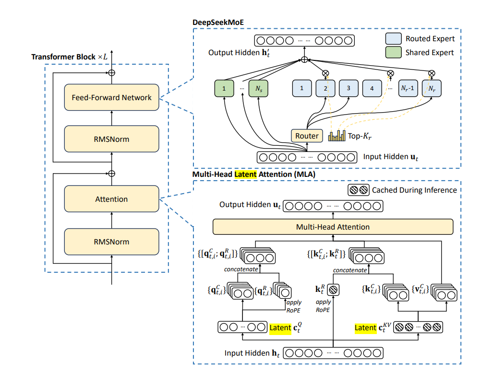
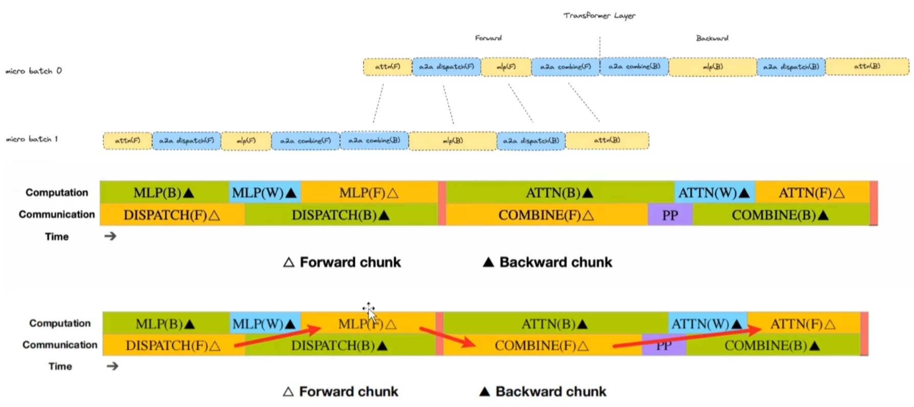
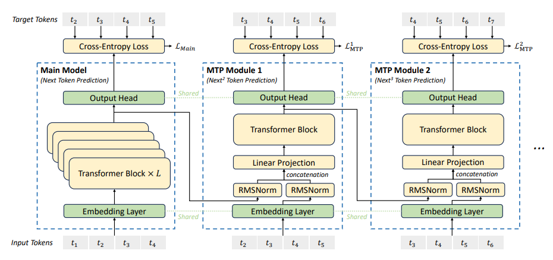
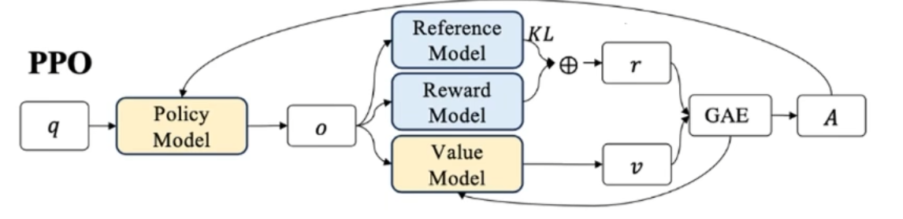
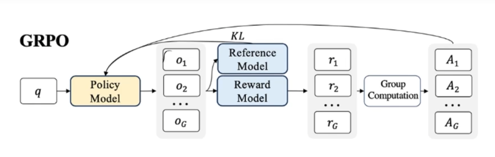
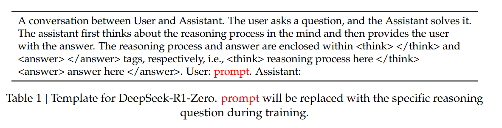
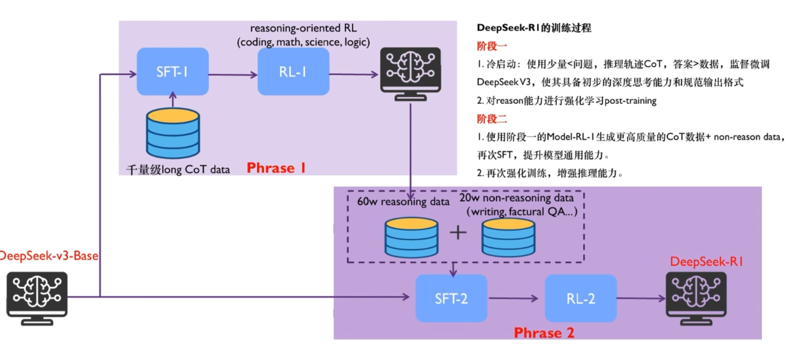

# DeepSeek-R1

## Model structure

DeepSeek-R1 基于 DeepSeek-V3-Base。这里先记录主干与部署设计，再看 R1 的后训练流程。

DeepSeek-R1 builds on DeepSeek-V3-Base. The following sections cover backbone and deployment designs, followed by R1 post-training.



### 1. MoE load balancing

部署时根据线上统计识别高负载专家，定期调整，例如每 10 分钟更新一次。为热点专家增加冗余副本，可以让 Token 在 GPU 之间分布得更均衡。

原 Prefill 部署示例使用 32 张 GPU，每张放置 8 个专家并增加一个冗余专家副本，以缓解计算负载倾斜。

Deployment statistics identify heavily loaded experts, with periodic updates such as every 10 minutes. Redundant copies of hot experts help balance token workloads across GPUs.

The Prefill deployment example uses 32 GPUs, with 8 experts and one redundant expert copy per GPU to reduce load imbalance.

### 2. MLA

MLA 对 Attention 的 K/V 做低秩联合压缩，降低推理时 KV Cache 的大小。

MLA jointly compresses Attention keys and values into a low-rank representation, reducing inference KV Cache storage.

### 3. Computation–communication overlap

在 MoE 与流水线并行中，让 GPU 计算与通信重叠：一边执行前向、反向等计算，一边接收或发送其他设备的数据。

MoE and pipeline execution overlap GPU computation with communication. A GPU can execute forward or backward work while receiving or sending data to other devices.



### 4. Multi-Token Prediction

DeepSeek-V3 主干训练加入 MTP，在当前上下文上预测多个未来位置，提高训练信号的利用率。图中可理解为在已有 Token 上增加后续多个位置的预测任务。

DeepSeek-V3 backbone training uses MTP to predict multiple future positions from the current context, making better use of training signals. The diagram adds prediction tasks for multiple future positions to the existing token context.



[DeepSeek-V3 technical report](https://arxiv.org/html/2412.19437v1)

## Training strategy

### 1. Why RL and GRPO

常见后训练流程是 SFT → RLHF。SFT 通过参考答案学习生成方式；RL 根据奖励评价采样回答，鼓励更好的结果。

DeepSeek 使用 GRPO，在同一问题的一组回答中计算相对 Advantage，省去单独的 Critic 模型。

A common post-training flow is SFT → RLHF. SFT learns from reference answers; RL evaluates sampled responses with rewards and favors better outcomes.

DeepSeek uses GRPO to calculate relative Advantage within a group of responses to the same prompt, avoiding a separate Critic model.

### 2. PPO, DPO, and GRPO

PPO 式 RLHF 常涉及以下模型：

- **Policy：** 当前训练的模型。
- **Reference：** 提供 KL 约束的固定参考模型。
- **Reward Model：** 评价回答质量。
- **Value Model：** 估计状态对应的预期回报。

PPO-style RLHF commonly involves:

- **Policy:** the model being trained.
- **Reference:** a fixed model supplying the KL baseline.
- **Reward Model:** evaluates response quality.
- **Value Model:** estimates expected return for a state.



DPO 直接从偏好数据优化模型；GRPO 则用组内相对奖励估计 Advantage，减少对 Value Model 的依赖。

DPO optimizes the model directly from preference data. GRPO estimates Advantage from group-relative rewards, reducing reliance on a Value Model.



### 3. Reward signals

- **PRM：** 提供中间步骤的过程反馈，信号更细，但构造和验证更复杂，也可能被模型钻空子。
- **ORM：** 根据最终答案打分，验证更直接，但难以定位每一步的贡献。

DeepSeek-R1-Zero 主要使用 Accuracy reward 和 Format reward，分别评价结果正确性和推理输出格式。

- **PRM:** provides feedback on intermediate reasoning steps, with finer signals but more complex construction and validation, and potential reward hacking.
- **ORM:** scores the final outcome, simplifying verification while providing less information about individual steps.

DeepSeek-R1-Zero mainly uses Accuracy and Format rewards to evaluate answer correctness and reasoning-output structure.

## DeepSeek-R1-Zero

R1-Zero 从 Base Model 直接进行 RL，不先做 SFT，主要依赖规则奖励。输入由 System Message 和问题构成。

训练中逐步出现更长的推理链、自检与反思行为。针对同一问题多次采样并多数投票，还可以提高最终答案的可靠性。

R1-Zero applies RL directly to a Base Model without an initial SFT stage, relying primarily on rule-based rewards. Inputs contain a System Message and a question.

Training progressively elicits longer reasoning chains, self-checking, and reflection. Multiple samples with majority voting can further improve final-answer reliability.



## DeepSeek-R1

先用 Cold Start 和面向推理的 RL 获得高质量推理数据，再结合通用数据进行 SFT，最后执行全场景 RL。

Cold Start and reasoning-oriented RL first produce strong reasoning data. SFT then combines reasoning and general-purpose data, followed by RL across all scenarios.



### 1. Cold Start

用少量高质量长 CoT 数据做 SFT，改善可读性和输出结构。数据可来自 Few-shot Prompt、引导检查答案的 Prompt、R1-Zero 的部分输出，以及人工整理。输出组织为推理过程与最终答案，原笔记用下面的结构示意。

SFT on a small set of high-quality long-CoT examples improves readability and output structure. Data can come from few-shot prompts, prompts encouraging answer verification, selected R1-Zero outputs, and human curation. Outputs separate reasoning from the final answer, illustrated by the original note's schematic below.

```
|special token|<reasoning_processing>special|<summary>|
```

### 2. Reasoning-oriented RL

继续用结果奖励提升推理能力，并加入语言一致性奖励，减少 R1-Zero 中的语言混杂问题。

Outcome rewards further improve reasoning, while a language-consistency reward reduces the language mixing observed in R1-Zero.

### 3. Rejection Sampling and SFT

从推理 RL 的 Checkpoint 多次采样，保留正确答案，并过滤混杂语言、过长段落和不合适的代码块等低可读性输出。

同时加入写作、角色扮演、事实问答等非推理数据。部分任务用 DeepSeek-V3 生成 CoT；简单问候等任务直接回答。

Sample multiple responses from the reasoning-RL checkpoint, retain correct answers, and filter outputs with mixed languages, overly long paragraphs, or unsuitable code blocks.

Add non-reasoning data for writing, role-playing, factual QA, and other general tasks. Some use CoT generated by DeepSeek-V3; simple greetings receive direct answers.

### 4. RL for all scenarios

结合不同 Prompt 分布和奖励信号，兼顾推理、通用能力、Helpfulness 和 Harmlessness。

Combine diverse prompt distributions and reward signals to balance reasoning, general capabilities, Helpfulness, and Harmlessness.

## Distillation

使用 DeepSeek-R1 生成的数据，对小模型执行 SFT，可以迁移推理能力。论文中的这些蒸馏模型只做 SFT，没有额外的 RL 阶段。

SFT on data generated by DeepSeek-R1 transfers reasoning capabilities to smaller models. The paper's distilled models use SFT without an additional RL stage.

[DeepSeek-R1 paper](https://arxiv.org/html/2501.12948v1)
