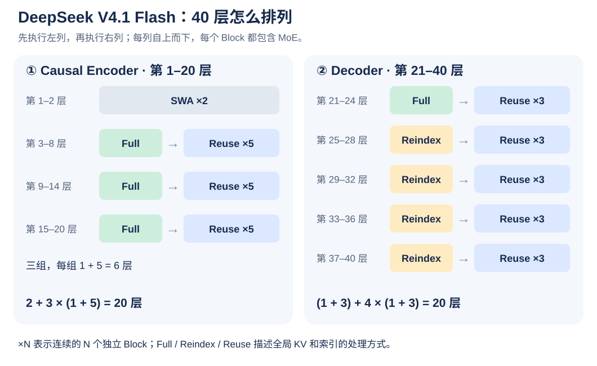

# DeepSeek V4.1 Flash

DeepSeek V4.1 Flash 的重点是：**用 CED 减少长输入的 Prefill 计算，用 CSA2 减少 KV 存储和重复索引。**

DeepSeek V4.1 Flash focuses on **reducing long-input Prefill computation with CED, and reducing KV storage and repeated indexing with CSA2**.

## 整体架构：20 层 Encoder + 20 层 Decoder

```text
文本 / 图像 → Embedding → Causal Encoder（20 层）→ Decoder（20 层）→ LM Head → Token 概率
                                  └─ 最后一层 Hidden States → Decoder 的全局 KV
```

这里的 Causal Encoder 也遵守因果约束，每个位置只能看到自己和之前的内容。40 层都由 Transformer Block 组成，各层有自己的可训练参数。

CED（Causal Encoder–Decoder）的关键是：**Decoder 的全局 KV 由 Encoder 最后一层的输出投影得到。**

- **Prefill：** 长 Prompt 主要经过 Encoder，并由其输出构建 Decoder 的全局 KV；Decoder 只需回放末尾一小段来准备局部 SWA 状态。
- **Decode：** 每个新 Token 依次经过 Encoder 和 Decoder，利用已有 KV 生成下一个 Token。

主干参数为 552B，另有 196B Engram 条件记忆参数；Prefill / Decode 每个 Token 的激活参数分别约为 8B / 16B。[官方模型卡](https://huggingface.co/deepseek-ai/DeepSeek-V4.1-Flash)

The backbone runs Embedding → 20-layer Causal Encoder → 20-layer Decoder → LM Head → token probabilities. The final Encoder Hidden States also supply the Decoder's global KV.

The Causal Encoder obeys causal visibility. All 40 layers are Transformer Blocks with their own trainable parameters.

The key CED design is that **Decoder global KV is projected from the final Encoder output**.

- **Prefill:** most long-prompt computation runs through the Encoder, whose outputs build Decoder global KV. The Decoder replays a short suffix to prepare local SWA states.
- **Decode:** each new token passes through both Encoder and Decoder, reusing existing KV to predict the next token.

The backbone has 552B parameters plus 196B Engram parameters. Activated parameters per token are about 8B for Prefill and 16B for Decode.

## 40 层怎么排列



每一项都是串行堆叠的 Block；`×N` 表示连续执行 N 层，每层有各自的参数。

- **Encoder：** `SWA ×2 +（Full + Reuse ×5）×3 = 20 层`。
- **Decoder：** `Full + Reuse ×3 +（Reindex + Reuse ×3）×4 = 20 层`。

架构图中的 `CSA2(2, Full)`，括号里的 `2` 是 KV 的序列压缩比；外面的 `×3`、`×5` 才是层的重复次数。Encoder 的 CSA2 压缩比为 2，Decoder 为 1。[技术报告 §4.2.1](https://arxiv.org/html/2609.19969v1#S4.SS2.SSS1)

Blocks execute serially. An external `×N` means N consecutive blocks, each with its own parameters.

- **Encoder:** `SWA ×2 + (Full + Reuse ×5) ×3 = 20 layers`.
- **Decoder:** `Full + Reuse ×3 + (Reindex + Reuse ×3) ×4 = 20 layers`.

In `CSA2(2, Full)`, the internal 2 is the sequence compression ratio, while external repetition counts describe layers. Encoder CSA2 uses ratio 2; Decoder CSA2 uses ratio 1.

## Attention：SWA 看近处，CSA2 找远处

**SWA（Sliding-Window Attention）** 只关注最近的 128 个 Token，保留局部细节。每层都有自己的 SWA；最前面的两层只使用 SWA。

其余层使用 CSA2（Compressed Sparse Attention 2），把两类信息一起交给 Attention：

| 分支 | 读取什么 | 作用 |
| --- | --- | --- |
| 局部 SWA | 最近 128 个 Token 的本层 KV | 保留连续的局部上下文 |
| 全局稀疏分支 | Indexer 选出的 Top-512 个全局 KV 条目 | 从较远的上下文中查找有用信息 |

Indexer 是负责筛选条目的轻量模块；主 Attention 再用自己的 Q 对选中的 KV 计算权重和输出。

**Top-512 指 KV 条目。** Encoder 将每 2 个 Token 压缩成一个全局条目；Decoder 的压缩比为 1，序列长度不压缩。

CSA2 同时做三件事：压缩全局 KV、跨层共享全局 KV、跨层复用 Top-K 选择。[技术报告 §2.3](https://arxiv.org/html/2609.19969v1#S2.SS3)

SWA attends to the most recent 128 tokens and preserves local details. Every layer has local SWA; the first two layers use only SWA.

The remaining layers use CSA2, combining local SWA KV with Top-512 global KV entries selected by a lightweight Indexer. The main Attention uses its own Q to weight the selected KV.

**Top-512 refers to KV entries.** The Encoder compresses every two tokens into one global entry; the Decoder uses ratio 1 with no sequence compression.

CSA2 combines global KV compression, cross-layer global KV sharing, and cross-layer Top-K index reuse.

## Full、Reindex、Reuse 的区别

全局 KV 包括供主 Attention 读取的 **main KV**，以及供 Indexer 打分的 **indexer K**。

| 当前层的工作 | Full | Reindex | Reuse |
| --- | --- | --- | --- |
| main KV、indexer K | 新建 | 复用最近 Full 层的结果 | 复用最近 Full 层的结果 |
| indexer Q | 计算 | 计算 | 无需计算 |
| Top-512 索引 | 重新选择 | 重新选择 | 沿用最近 Full / Reindex 层的选择 |
| 主 Attention 的 Q | 自己计算 | 自己计算 | 自己计算 |
| SWA KV、Attention 输出 | 自己计算 | 自己计算 | 自己计算 |

- **Full：** 建 KV，再选条目，执行完整的 CSA2 路径；主 Attention 仍然是稀疏的。
- **Reindex：** 使用同一份 KV，换一个 Query 重新挑选条目。
- **Reuse：** 使用同一份 KV 和同一份条目选择，用本层的 Q 重新计算 Attention。

所以 Reuse 层仍然执行 Attention、MoE 等计算。共享的是中间 KV 和索引，各层仍有自己的 Query、输出投影和专家参数。[技术报告 §2.3.1](https://arxiv.org/html/2609.19969v1#S2.SS3.SSS1)

Decoder 还使用**分层索引**：第一个 Full 层搜索整个可见上下文，并建立较大的候选池；后续 Reindex 层只在候选池中重选 Top-512。候选池最多有 16,384 个位置，与最终用于 Attention 的 512 个条目分开。[技术报告 §2.3.2](https://arxiv.org/html/2609.19969v1#S2.SS3.SSS2)

Global KV includes **main KV** for Attention and **indexer K** for selection scoring.

| Current-layer work | Full | Reindex | Reuse |
| --- | --- | --- | --- |
| main KV and indexer K | Create | Share the latest Full layer's result | Share the latest Full layer's result |
| indexer Q | Compute | Compute | Omit |
| Top-512 indices | Select afresh | Select afresh | Reuse the latest Full / Reindex selection |
| Main Attention Q | Compute locally | Compute locally | Compute locally |
| SWA KV and Attention output | Compute locally | Compute locally | Compute locally |

**Full** builds KV and selects entries, executing the complete CSA2 path while retaining sparse Attention. **Reindex** shares KV but uses a new indexer query to reselect entries. **Reuse** shares both KV and indices, then computes Attention using its own Q.

Reuse layers still execute Attention and MoE. They share intermediate KV and indices while retaining their own Query, output projections, and expert parameters.

The Decoder also uses hierarchical indexing: its first Full layer searches the visible context and builds a candidate pool. Later Reindex layers select their own Top-512 within that pool, which contains up to 16,384 positions.

## Top-512 复用了，最近 128 个还要重算吗

**跨层复用针对全局 KV 和 Top-512 索引。局部 SWA KV 仍由每层分别维护。**

正常逐 Token Decode 时，每层保留窗口中的历史 KV，只计算当前 Token 的新 KV，并移出窗口外的旧条目。因此，同一步里各层使用各自的局部 KV；连续生成时也能沿用本层前一步留下的缓存。

**SWA Bounded Replay** 用于准备或恢复缺失的 SWA 状态：只回放最近 128 个 Token，近似重建局部 KV。这样可以省去把 SWA KV 长期保存到 SSD 的开销。它发生在缓存准备 / 恢复时，正常 Decode 继续增量维护窗口。[技术报告 §3.2.2](https://arxiv.org/html/2609.19969v1#S3.SS2.SSS2)

**Cross-layer reuse applies to global KV and Top-512 indices. Each layer maintains its own local SWA KV.**

During ordinary token-by-token Decode, a layer keeps KV within its window, computes new KV for the current token, and evicts entries outside the window. Different layers use different local KV, while each layer reuses its own previous-step cache.

**SWA Bounded Replay** prepares or recovers missing local states by replaying only the most recent 128 tokens and approximately reconstructing SWA KV. This avoids persistent SSD storage for SWA KV. Ordinary Decode continues updating the window incrementally.

## MoE 与反向传播

每个 Block 的 FFN 使用 MoE：**1 个共享专家 + 384 个路由专家，每个 Token 选择其中 6 个路由专家。** Router 负责给专家打分，选中的专家处理该 Token，再聚合输出。[官方模型配置](https://huggingface.co/deepseek-ai/DeepSeek-V4.1-Flash/blob/main/config.json)

从单个 Token 看，梯度主要沿这些路径传播：

| 模块 | 梯度如何传播 |
| --- | --- |
| 选中的 6 个专家、共享专家 | 通过各自的计算路径得到梯度 |
| 未选中的专家 | 没有来自该 Token 的专家计算梯度；Batch 中其他 Token 可能选中它们 |
| Router | 通过选中专家的可微路由权重得到梯度；离散 Top-K 选择本身不直接求导 |
| 本层 Query、SWA、输出投影、Norm 等 | 沿本层计算路径得到梯度 |
| 跨层共享的全局 KV | 使用它的多个层贡献的梯度汇合，再传回生成 KV 的投影和输入 |

对 Decoder 的共享全局 KV，这条路径还会回到 **Encoder 最后一层的输出**。推理时缓存 KV 用来省计算；训练时共享 KV 的计算图仍然需要保留相应的梯度路径。

其余模块先记住作用即可：**Single-Pass mHC** 混合多条残差流，**Engram** 提供按 Token 组合查找的条件记忆，**DSpark** 用推测解码加速生成。[官方模型卡](https://huggingface.co/deepseek-ai/DeepSeek-V4.1-Flash)

Every Block uses an MoE FFN with **1 shared expert and 384 routed experts, selecting 6 routed experts per token**. The Router scores experts, selected experts process the token, and their outputs are aggregated.

| Component | Gradient path for one token |
| --- | --- |
| Selected 6 experts and shared expert | Receive gradients through their computation |
| Unselected experts | No expert-computation gradient from this token; other batch tokens may select them |
| Router | Receives gradients through differentiable selected routing weights; discrete Top-K itself is not directly differentiated |
| Local Query, SWA, output projections, and Norm | Receive gradients through local computation |
| Shared global KV | Contributions from consuming layers accumulate and flow into the KV projections and inputs |

For shared Decoder global KV, the gradient also reaches the **final Encoder output**. Inference caches save computation; training preserves the necessary gradient paths through shared KV.

**Single-Pass mHC** mixes residual streams, **Engram** provides conditional memory indexed by token combinations, and **DSpark** accelerates generation with speculative decoding.
