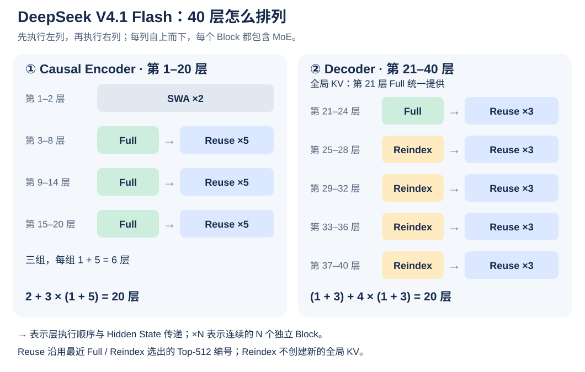
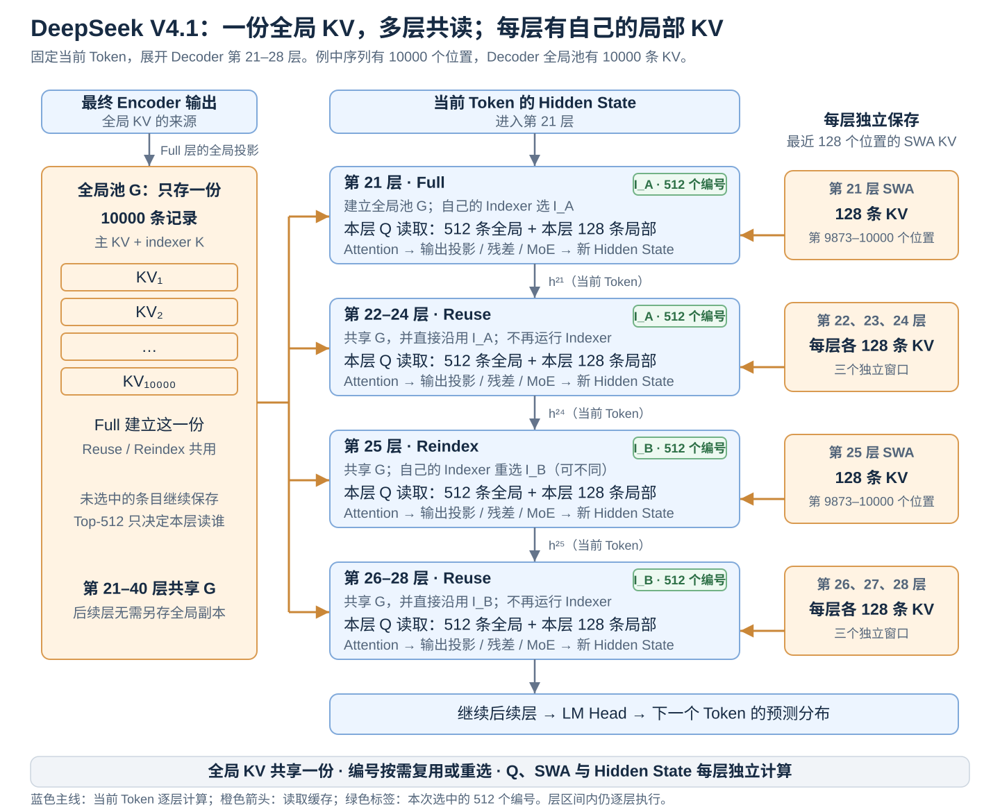
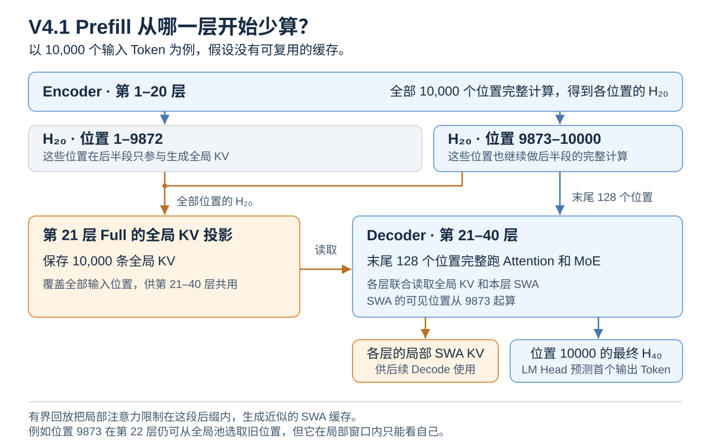

# DeepSeek V4.1 Flash

V4.1 的主线是**跨层共享全局 KV**。少数 Full 层建立全局缓存，各层用自己的 Q 和局部 SWA 更新 Hidden State。这个结构既减少缓存副本，也让长输入的 Prefill 可以省去后半段的大量计算。

V4.1 shares global KV across layers. A few Full layers build the global caches, while each layer uses its own Q and local SWA to update the hidden state. This reduces cache copies and lets long-input Prefill skip much of the computation in the second half.

- [1 整体骨架](#1-整体骨架)
- [2 核心注意力：一份全局池如何供多层使用](#2-核心注意力一份全局池如何供多层使用)
- [3 缓存为什么变小](#3-缓存为什么变小)
- [4 KV 共享为什么能加快 Prefill](#4-kv-共享为什么能加快-prefill)

## 1 整体骨架

模型依次执行 **20 层 Causal Encoder → 20 层 Decoder → LM Head**。两部分都遵守因果约束；Decode 时，当前 Token 穿过全部 40 层。关键连接是：**Decoder 的全局 KV 从最终 Encoder 输出生成，而局部 SWA 仍从各层自己的输入生成。**



先执行左列 Encoder，再执行右列 Decoder；每列自上而下。`→` 表示层执行顺序与 Hidden State 传递，`×N` 表示串行执行 N 个独立 Block。Reuse 沿用最近 Full / Reindex 选出的 Top-512 编号；图中箭头不表示全局 KV 的来源。

全模型的 **4 份全局 KV 来源**分别位于 Encoder 第 3、9、15 层和 Decoder 第 21 层，各组内共享；40 层各自保留局部 SWA。前两层只做 SWA，之后 38 层同时读取局部与全局 KV。每个 Block 还包含 MoE。

The model runs **20 Causal Encoder layers → 20 Decoder layers → LM Head**. Both halves obey causality; each Decode token traverses all 40 layers. **Decoder global KV is projected from the final Encoder output, while local SWA is generated from each layer's own input.**

Run the Encoder column first, then the Decoder column, top to bottom within each. `→` shows execution order and hidden-state flow; `×N` denotes N sequential, independent blocks. Reuse inherits Top-512 indices from the latest Full / Reindex. The arrows do not indicate global-KV ownership.

The **four global KV sources** are Encoder layers 3, 9, 15 and Decoder layer 21, shared within their groups. All 40 layers maintain independent local SWA windows. The first two layers use SWA only; the other 38 read both local and global KV. Every block also contains MoE.

## 2 核心注意力：一份全局池如何供多层使用

固定当前 Token，看它穿过 Decoder 的实际第 21–28 层。**左侧是共享的全局 KV 池，右侧是每层独立的 128 条 SWA，中间是逐层更新的 Hidden State。** 例中有 10000 个可见位置，因此 Decoder 全局池有 10000 条记录。



沿中间主线看：Full 建池并选出 Top-512 编号 I_A；后续 Reuse 同时复用池和 I_A。Reindex 共用这个池，用自己的 Indexer 重选 I_B，随后 Reuse 沿用 I_B。**三种层都用自己的主 Q，对“512 条所选全局 KV + 本层 128 条 SWA KV”共同做 Attention，再经输出投影、残差路径和 MoE 更新 Hidden State。**

这里有三个容易混淆的边界：**Full 也做稀疏 Attention；Top-512 是读取量，未选条目继续保存；Reuse 仍执行本层计算。** 局部与全局可以覆盖相同的 Token 位置，两路表示共同参加一次 Attention 归一化。

长上下文时，Decoder 的首个 Full 层还建立一个较大的候选池，后续 Reindex 只在其中重选 Top-512。候选池最多由 `2048 个块 × 8 个位置 = 16384 个位置` 组成，用来减少重复索引的计算；它与最终读取的 512 条不是同一数量。

Hold the current token fixed through actual Decoder layers 21–28. **The left is one shared global KV pool, the right is each layer's own 128-entry SWA window, and the middle is the evolving hidden state.** This example has 10000 visible positions and 10000 Decoder global entries.

Follow the central path: Full creates the pool and selects Top-512 indices I_A; following Reuse layers share both. Reindex shares the pool but runs its own Indexer to select I_B, which subsequent Reuse layers inherit. **All three modes use their own main Q to attend jointly to 512 selected global entries and 128 layer-local SWA entries, then update the hidden state through output projection, residual processing, and MoE.**

Three distinctions matter: **Full still uses sparse Attention; Top-512 counts entries read while unselected entries remain cached; Reuse still performs layer computation.** Local and global entries may cover overlapping token positions and participate in one Attention normalization.

For long contexts, the first Decoder Full layer also builds a larger candidate pool, restricting later Reindex searches. Up to `2048 blocks × 8 positions = 16384 positions` can enter this pool, reducing repeated indexing work; the final read remains Top-512.

## 3 缓存为什么变小

### 3.1 少存全局条目，也少存跨层副本

沿用 **10000 个 Token 位置**的例子。Encoder 的每个全局来源把相邻两个位置的投影聚成一条，Decoder 的来源按 1:1 保存。**压缩改变 KV 记录数，原始 Token 位置数仍为 10000。**

| 缓存 / Cache | 保存数量 / Stored entries | 共享范围 / Sharing scope |
| --- | --- | --- |
| Encoder 全局 KV / Global KV | `3 个来源 × 每份 5000 条` / 3 sources × 5000 | 每份供本组 Full 与后续 5 个 Reuse 层使用 / Each serves its Full layer and next 5 Reuse layers |
| Decoder 全局 KV / Global KV | `1 个来源 × 10000 条` / 1 source × 10000 | 第 21–40 层共用 / Shared by layers 21–40 |
| 局部 SWA / Local SWA | `40 层 × 每层 128 条` / 40 layers × 128 | 各层独立维护 / Independent per layer |

每条全局记录包含 **512 维主 KV + 128 维 indexer K**。主 KV 的同一份 512 维数据直接充当 K 和 V，64 个主 Query heads 共同读取；既不为每个 head 复制，也不另存一份 V。512 维已包含 64 维 RoPE 分量。

Keep the same **10000 token positions**. Each Encoder global source pools adjacent pairs into one entry; the Decoder source stores one per position. **Compression changes KV-entry counts while preserving the original 10000 token positions.**

Each global record contains **512-dimensional main KV and a 128-dimensional indexer key**. The same main vector serves as K and V for all 64 query heads, without per-head copies or a separate V copy. Its 512 dimensions already include 64 RoPE dimensions.

### 3.2 FP4 再减少每条记录的字节数

全局主 KV 和 indexer K 都量化为 FP4；量化 scale 也占空间。局部 SWA 使用 FP8。

| 全局记录的数据 / Global record data | 数值 / Values | Scale | 合计 / Total |
| --- | --- | --- | --- |
| 主 KV / Main KV | `512 × 0.5 = 256 B` | `512 / 16 × 1 = 32 B` | 288 B |
| indexer K | `128 × 0.5 = 64 B` | `128 / 32 × 1 = 4 B` | 68 B |
| 每条记录 / Per record | 320 B | 36 B | **356 B** |

按原始 Token、跨全模型摊销，全局缓存约为 **890 Bytes/Token**：

```math
B_{\mathrm{global}}(T)=\left(3\left\lfloor T/2\right\rfloor+T\right)\times356
\approx T\times(3/2+1)\times356=890T\ \mathrm{Bytes}
```

T=10000 时，全局缓存为 `25000 × 356 = 8,900,000 B`。这个口径只包含全局主 KV 与 indexer K；局部 SWA、索引管理、未满压缩组的临时状态、模型权重和运行激活另计。

**权重与缓存的区别：** 投影矩阵、Norm 的 γ、Indexer 等模块参数是训练得到的模型权重；主 KV、indexer K、SWA KV 是随输入产生的缓存数据。Q 和 Attention 权重用于当前计算，通常不存入历史 KV Cache。

Global main KV and indexer K use FP4, including additional storage for quantization scales. Local SWA uses FP8.

As shown in the formula above, amortized per original token across the model, global caching costs approximately **890 Bytes/Token**.

For T=10000, global caching occupies `25000 × 356 = 8,900,000 B`. This counts only global main KV and indexer K; local SWA, index management, partial compression groups, model weights, and runtime activations are additional.

**Weights versus caches:** projection matrices, Norm gains, and Indexer parameters are learned model weights. Main KV, indexer K, and SWA KV are input-dependent cached data. Queries and Attention weights serve current computation and are normally absent from historical KV caches.

## 4 KV 共享为什么能加快 Prefill



### 4.1 全局 KV 在第 20 层输出后就能准备好

沿用 10000 个输入 Token 的例子，假设没有可复用的缓存。**全部 10000 个位置都算到第 20 层。** 第 21 层的 Full 用这些位置的 H₂₀ 投影出 10000 条全局 KV，供第 21–40 层共用。

这与第 2 节图中的共享关系是同一件事。**后半段所需的历史全局 KV 只依赖 H₂₀**，所以准备这份缓存时，可以跳过旧位置在后半段的 Attention 和 MoE。最后一个输入位置仍需算到第 40 层，用它的最终 Hidden State 预测第一个输出 Token。

For a 10,000-token prompt with no reusable cache, **all 10,000 positions run through layer 20**. The Full layer at 21 projects their H₂₀ states into 10,000 global KV entries shared by layers 21–40.

This is the sharing shown in Section 2. **The second half's global KV depends only on H₂₀**, so building it can skip Attention and MoE in the second half for older positions. The final input position still runs through layer 40, and its hidden state predicts the first output token.

### 4.2 用末尾 128 个位置准备各层的 SWA

全局 KV 准备好后，后半段还要建立各层自己的 SWA。**单层窗口是 128，但精确计算所需的历史会跨层向前延伸。** 例如第 22 层在位置 `9873` 做 SWA 时，正常窗口会使用位置 `9872` 的 KV，而这条 KV 来自第 21 层在 `9872` 的输出。这样就依赖了末尾 128 个位置之外的层计算。

部署时，**SWA Bounded Replay** 让位置 `9873–10000` 继续跑后 20 层，并将每层的局部窗口截在这段后缀内。较早的位置仍可通过全局 KV 被选中。这样能用短后缀准备各层的局部缓存，得到的是近似状态。进入 Decode 后，每步只处理一个新位置，复用已有窗口并写入当前 KV。

The Decoder still needs a separate SWA cache at each layer. **The window spans 128 positions per layer, and the dependencies of exact computation reach further back across layers.** At position `9873`, layer 22 would normally read the local KV at `9872`, which depends on the layer 21 output at that earlier position.

With **SWA Bounded Replay**, positions `9873–10000` traverse the last 20 layers and each SWA window is clipped to that suffix. Earlier positions remain accessible through global KV. This prepares approximate local caches from a short suffix. Each Decode step then processes one new position and updates its windows incrementally.

| 阶段 / Phase | 前 20 层的计算位置 / Positions through layers 1–20 | 后 20 层的完整计算位置 / Positions through all of layers 21–40 |
| --- | --- | --- |
| Prefill，预测第一个输出 Token / Predict the first output token | `1–10000` | `9873–10000` |
| 首次单步 Decode，预测第二个输出 Token / Predict the second output token | `10001` | `10001` |
