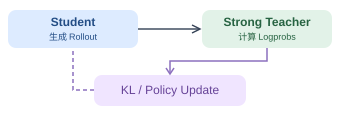
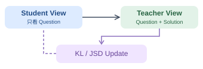
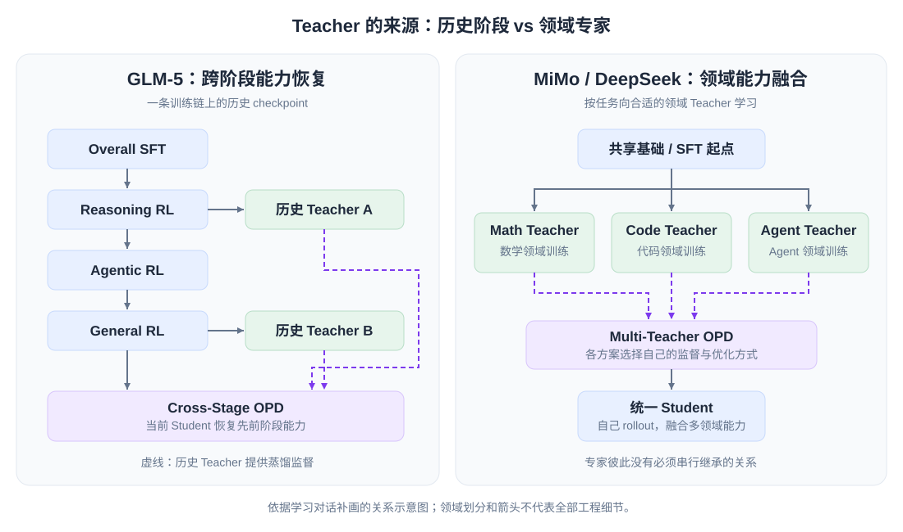
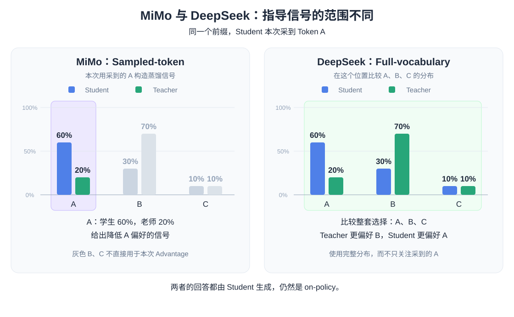

# OPD 学习笔记

**OPD（On-Policy Distillation）就是：学生自己做题，老师针对学生实际走出的步骤提供指导。**

下文用 Student 表示待训练的学生模型，Teacher 表示提供指导的老师模型。

## 1. 为什么需要 OPD？

可以用学下棋来理解三种学习方式：

| 方式 | 类比 | 优点与不足 |
| --- | --- | --- |
| 只给最终结果奖励的 RL | 自己下棋，结束后只知道输赢 | 能练习自己的走法，但难以判断具体哪一步出了问题 |
| 离线蒸馏 / 常见的 SFT | 看大师棋谱，逐步模仿 | 每一步都有学习目标，但大师遇到的局面可能与自己不同 |
| OPD | 自己下棋，让教练针对当前局面指导 | 既练习自己会遇到的局面，又得到逐步反馈 |

这里的“奖励稀疏”特指只给最终结果的 RL（ORM）；RL 也可以提供过程奖励（PRM）。

### 离线学习的两个问题

**分布偏移 / Exposure Bias（暴露偏差）：训练看老师的路径，推理走自己的路径。**

训练时，学生接着 Teacher 或参考答案的前文往下写；推理时，却要接着自己生成的前文写。一旦偏离参考路径，就可能遇到训练没充分覆盖的状态，不知道怎么纠错，错误便可能累积。

**Confident Conflict（强迫冲突）：学生很确信另一种续写，却被要求模仿指定的 Token。**

当学生已经很有把握，却被外部答案要求输出一个自己认为很不可能的 Token 时，就出现了监督冲突。持续拟合这些冲突，可能扰动原有能力、加重遗忘。这里不只是“目标概率低”，也包括“学生对另一种选择很确信”。参考 [Diao et al.](https://arxiv.org/abs/2601.02151)。

前者关注**走到的状态不同**，后者关注**当前状态下的选择冲突**，两者不能直接画等号。

OPD 的思路是：让老师来指导学生自己的路径，减少训练与实际使用之间的差距。它能提供更密集的学习信号，但不保证消除所有错误或遗忘。

## 2. OPD 怎么训练？

1. **学生先做。** Student 根据问题生成回答，这次尝试称为 rollout。
2. **老师沿途指导。** Teacher 查看学生已经写出的前文，对下一 Token 的选择给出概率或评分。
3. **学生调整。** 根据指导更新 Student，再生成新回答，重复训练。

**On-policy 指的是：练习内容来自学生当前的策略。** Teacher 不必重新生成完整标准答案，也不一定要比 Student 更大，只需在目标能力上提供有效指导。

## 3. 两个常见方向：OPSD 与 MOPD

OPD 是整体范式；OPSD 和 MOPD 主要区别在于 **Teacher 从哪里来**。

| 方向 | Teacher 是谁？ | 主要目的 |
| --- | --- | --- |
| 常见 OPD | 独立老师或已有模型版本 | 迁移老师的目标能力 |
| OPSD：自我蒸馏 | 同源模型，但 Teacher 额外看到参考解法 | 把“看过解法后”的能力学进模型 |
| MOPD：多教师蒸馏 | 多个领域老师，如数学、代码、Agent 专家 | 把不同专长融合进一个学生模型 |

### OPSD：同一个模型，看到的信息不同

Student 只看问题，Teacher 额外看参考答案或解法。虽然模型同源，输入的信息不同，给出的指导也可以不同。训练后，Student 仍然需要独立回答问题。

参考 [Self-Distilled Reasoner](https://arxiv.org/abs/2601.18734)。

### MOPD：多个老师，教同一个学生

数学任务向数学专家学习，代码任务向代码专家学习，最终更新的是同一个 Student。多教师不意味着每个 Token 都要请全部老师来评价。

本文的 MOPD 指 **Multi-Teacher OPD**；另有同名的 Multi-Rollout OPD，阅读论文时注意全称。

## 4. 模型案例：恢复旧能力，还是融合新能力？

先看 Teacher 的来源，再看指导方式。

| 模型 | Teacher 来源 | 主要目的 | 指导方式的特点 |
| --- | --- | --- | --- |
| [GLM-5](https://arxiv.org/html/2602.15763v2#S3.SS5) | 先前训练阶段保存的模型版本 | 恢复串行训练中退化的能力 | 用历史 Teacher 指导学生的逐 Token 选择 |
| [MiMo-V2-Flash](https://arxiv.org/html/2601.02780v2#S4.SS4) | 各领域的专业 Teacher | 融合多个领域的能力 | 老师逐 Token 指导，同时结合最终结果奖励 |
| [DeepSeek-V4](https://arxiv.org/html/2606.19348v1#S5.SS1.SSS2) | 多个领域专家 | 融合多个领域的能力 | 在学生访问的位置比较完整词表分布 |

### Teacher 的关系不同

**GLM-5：沿训练阶段找老师。** 模型依次学习推理、Agent、通用能力后，部分旧能力可能下降。于是把先前阶段保存的模型当作 Teacher，进行跨阶段蒸馏。

**MiMo / DeepSeek：按领域找老师。** 分别培养不同领域的专家，再把它们的专长蒸馏到一个 Student。专家之间主要是领域分工，不是数学老师训练完再接着变成代码老师。

### 指导信号的范围不同

- **Sampled-token：** 用学生实际生成的那个 Token 的概率差异提供指导。GLM、MiMo 的上述方案采用这类信号。
- **Full-vocabulary：** 在同一位置比较所有候选 Token 的概率分布。DeepSeek-V4 使用这种方式，信息更完整，计算和存储成本也更高。

#### 用概率分布来理解

假设同一个位置只能接 A、B、C 三种 Token：Student 的概率分别是 **60%、30%、10%**，Teacher 则是 **20%、70%、10%**。Student 这次实际生成了 A。

- **MiMo：关注这次采到的 A。** 学生很偏好 A，但老师给 A 的概率更低，所以本次蒸馏信号会引导学生降低对 A 的偏好。B、C 的概率不直接用于构造本次 sampled-token 蒸馏信号。
- **DeepSeek：比较整套选择。** 同时看 A、B、C 的概率分布，既看到学生过于偏好 A，也看到老师更偏好 B，利用完整分布来指导调整。

Full-vocabulary 仍然可以是 on-policy：**回答由学生生成，只是在回答经过的位置比较完整词表，而不是遍历所有可能的回答。**

## 相关笔记

- [PPO 与 GRPO](../rl/ppo-grpo.md)
- [DeepSeek-R1](../../model-studies/deepseek-r1/deepseek-r1.md)
