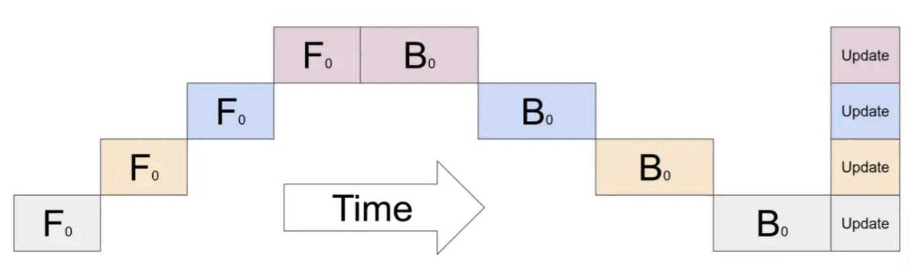
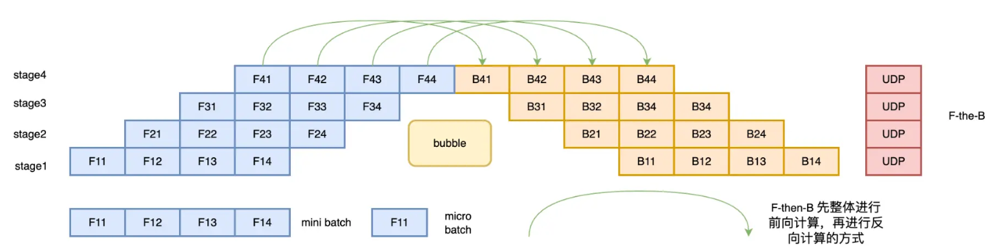
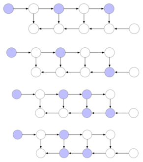
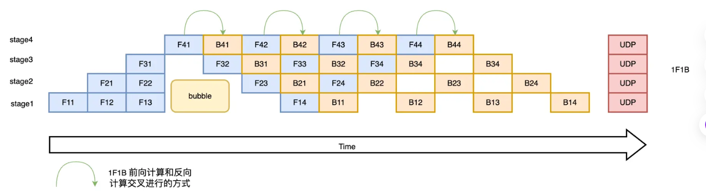

# Pipeline Parallelism

## Definition

Pipeline Parallelism 将模型按顺序拆成多个 Stage，分配到不同 GPU 或机器上，以流水线方式训练。

Pipeline Parallelism splits a model into sequential stages assigned to different GPUs or machines, then trains them as a pipeline.

## Key points

1. **模型划分：** 每个 Stage 分配到不同 GPU。例如 12 层模型使用 4 张 GPU，每张负责 3 层。
2. **Micro-batch：** 把一个 Batch 拆成多个更小的 Micro-batch，依次送入流水线。
3. **流水线执行：** GPU 2 处理第一个 Micro-batch 时，GPU 1 可以开始第二个，从而提高利用率。
4. **前向与反向：** 激活沿 Stage 向后传，反向传播时梯度沿相反方向传回。
5. **梯度累积与更新：** 累积 Micro-batch 梯度后，各 Stage 更新自己的参数；同时使用 DP 时，还要在对应 DP 组中同步梯度。

The pipeline operates as follows:

1. **Model partitioning:** assign each stage to a different GPU. A 12-layer model on 4 GPUs might place 3 layers on each GPU.
2. **Micro-batches:** split a batch into smaller units that enter the pipeline sequentially.
3. **Pipeline execution:** GPU 1 can start the second micro-batch while GPU 2 handles the first, improving utilization.
4. **Forward and backward:** activations move downstream, while gradients flow back through the stages.
5. **Gradient accumulation and updates:** accumulate micro-batch gradients, then update each stage's parameters. When combined with DP, synchronize gradients within the corresponding DP groups.

## Scheduling

### Naive

最简单的调度依次执行各个 Stage，其余 GPU 等待，流水线空泡较多。

A naive schedule executes stages sequentially while other GPUs wait, leaving substantial pipeline bubbles.

### F-then-B

先完成多个 Micro-batch 的前向，再统一反向。它能重叠不同 Stage 的计算，但需要保留较多中间激活，增加显存占用。

F-then-B completes forward passes for multiple micro-batches before running backward passes. It overlaps stages but retains many intermediate activations, increasing memory usage.

### Activation checkpointing

只保存部分激活作为 Checkpoint，反向时重新计算未保存的激活。图中紫色节点保留，白色节点在反向阶段重算，用额外计算换取更少的显存占用。

Activation checkpointing saves selected activations and recomputes the others during backward. Purple nodes are retained; white nodes are recomputed, trading additional computation for lower memory usage.

### 1F1B

进入稳定阶段后交替安排一次前向和一次反向。每个 Micro-batch 完成反向后，就可以释放对应激活，降低同时保留的激活数量。

After warmup, 1F1B alternates forward and backward work. Activations can be released once a micro-batch's backward pass finishes, reducing the number retained at once.

